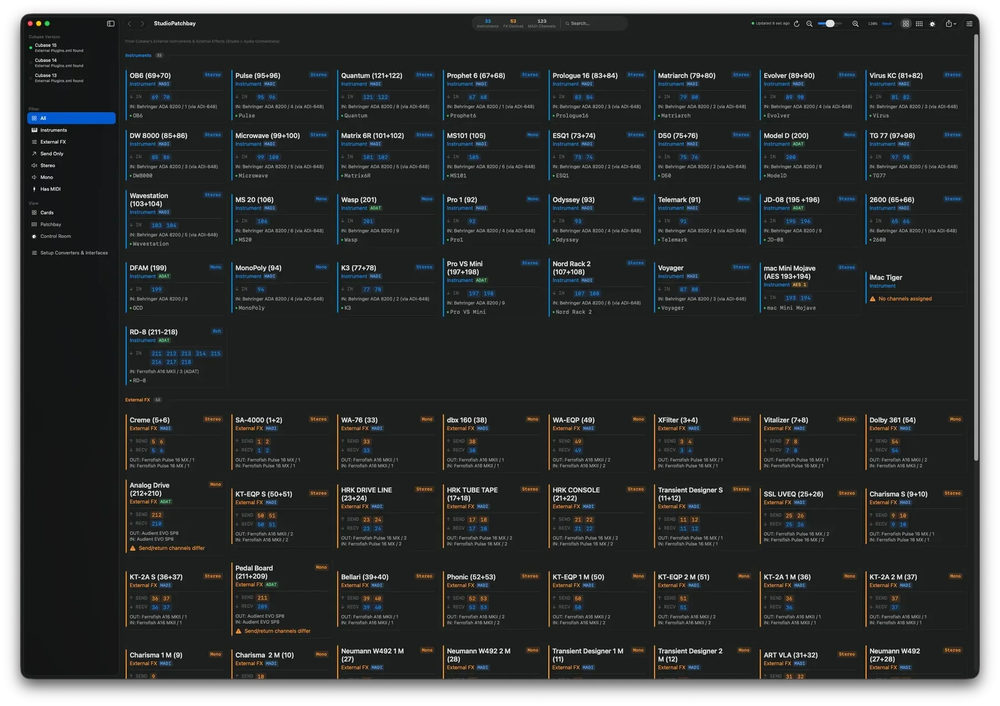
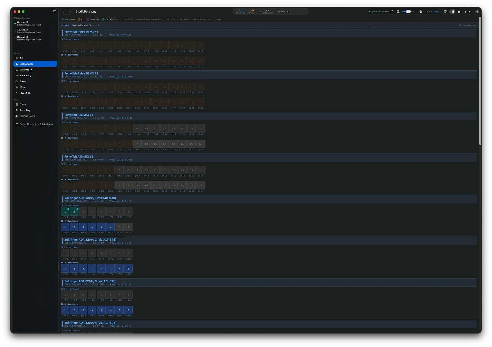
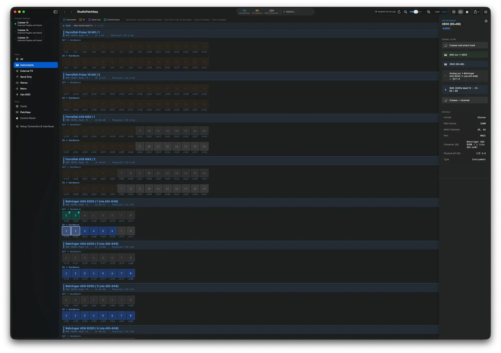
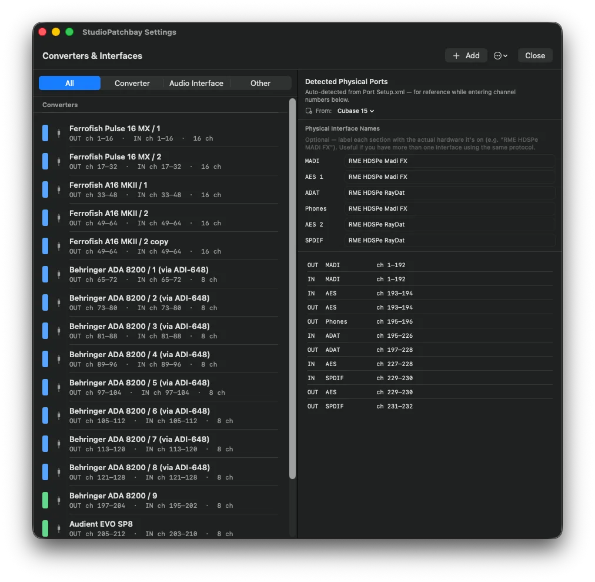

# Studio Patchbay

[](https://github.com/painfilter/StudioPatchbay/actions/workflows/ci.yml)

A native macOS app that visualises your Cubase external devices (instruments, FX, sends)
as a live patchbay, reading directly from Cubase's `External Plugins.xml` preference file.

## Screenshots

**Cards.** Every external device Cubase knows about, grouped by type, with its
channels, stereo/mono format and MIDI assignment.



**Patchbay.** The whole channel space laid out per converter/interface, the OUT
row above the IN row, colour-coded by device type. Unused channels stay dimmed.



**Detail panel.** Click any card or channel cell to trace that device's whole
signal flow: out of the Cubase track, through the converter and interface, and
back in, plus its format, MIDI device and channel assignments.



**Converters and interfaces.** Map each converter to its channel range. The
physical ports are auto-detected from Cubase's `Port Setup.xml`.



## Features

- **Auto-detects all Cubase versions.** Scans `~/Library/Preferences/Cubase NN/`
  for any version 12 or higher, so future releases are picked up with no code
  change.
- **Live file watching.** Uses `DispatchSource` (kqueue) to watch the XML file.
  When Cubase exits and writes its preferences, the app reloads within ~400ms
  automatically. A green indicator in the toolbar shows the watcher is active.
- **Two views:**
  - *Cards*, each device grouped by type (Instruments, External FX, FX Sends),
    showing MADI channel numbers, stereo/mono format and MIDI device assignment.
  - *Patchbay*, the full MADI channel space as a grid. Instruments are blue,
    FX are orange, send-only routes are purple. Unused channels are dimmed.
- **Detail panel.** Click any card or channel cell to see the full signal flow
  chain for that device, plus a warning if send and return channels differ.
- **Filtering and search** by type, format (stereo/mono), or MIDI assignment.

## Requirements

- **Runs on macOS 15 (Sequoia) or later.** On macOS 26 (Tahoe) the toolbar uses
  the Liquid Glass APIs (`sharedBackgroundVisibility`, `ToolbarSpacer`). On
  earlier macOS it falls back to the standard toolbar automatically.
- **Builds with Xcode 26 or later.** The macOS 26 SDK is needed to compile the
  availability-guarded Liquid Glass code, which still runs on macOS 15.
- Cubase 12 or later (any version that writes `External Plugins.xml`).

## Build and run

1. Open `StudioPatchbay.xcodeproj` in Xcode
2. Select your Mac as the run destination
3. Press ⌘R

No signing setup is needed for local development, Xcode will use automatic signing.

## Tests

The parsing layer is what breaks when Steinberg changes a preference file, so it
is covered by tests and kept free of any UI dependency. It builds as a small
Swift package, so the tests run without building the app at all:

```bash
swift test
```

`Package.swift` compiles only `ExternalPluginsParser`, `PortSetupParser` and
`ControlRoomParser`. The app itself is still built from the Xcode project. CI
runs the same `swift test` on every push.

## Cross-platform version (JUCE, macOS and Windows)

The `JUCE/` folder holds a C++ rewrite of the app on [JUCE](https://juce.com)
with a classic Mac OS 9 "Platinum" interface. It runs on macOS and Windows and
will replace the Swift app once it is complete.

Requirements: CMake 3.24 or later and a C++20 compiler (Xcode on macOS,
Visual Studio 2022 on Windows). JUCE and Catch2 are downloaded by CMake.

```bash
cmake -S JUCE -B build -DCMAKE_BUILD_TYPE=Release
cmake --build build --config Release
ctest --test-dir build -C Release --output-on-failure
```

Cubase's preferences are read from `~/Library/Preferences/Cubase NN/` on macOS
and `%APPDATA%\Steinberg\Cubase NN_64\` on Windows (version 12 or later).
It shares its converter/interface setup with the Swift app
(`physicalDevices.json` and `portLabels.json` in the same folder), and offers
the same views: Cards, Patchbay and Control Room, with filter, search, the
detail panel's signal flow and the Converters & Interfaces window. The
interface is in English or German (Options > Language).

**File > Export Patchbay as PDF/PNG** writes the patchbay as the Swift app
does: everything, 1400 pixels wide, with what is connected listed under each
block. The current view can be exported too. From a script:

```bash
StudioPatchbay --export patchbay.pdf
```

Collapse the window (the box at the right of its title bar) to reach the
desktop: each Cubase installation, Converters & Interfaces, the export
programs, the file watcher, your last exports, and the trash, which opens
About.

## Why no sandbox?

The app reads `~/Library/Preferences/Cubase NN/External Plugins.xml` directly.
The macOS sandbox would require the user to grant access via a file picker each
launch, which defeats the purpose of seamless live reloading. This app is not
intended for Mac App Store distribution. If you ever want to sandbox it, replace
the direct file read with a security-scoped bookmark persisted in `UserDefaults`.

## File location logic

`CubaseDetector.swift`, in `detectCubaseInstallations()`, scans
`~/Library/Preferences/` for directories matching `Cubase NN` where NN is 12 or
higher. Later versions are therefore picked up automatically with no code
changes. The app defaults to the highest version that has an
`External Plugins.xml` present.

## How the file watcher works

`FileWatcher.swift` opens the file with `O_EVTONLY` and creates a
`DispatchSource.makeFileSystemObjectSource` watching for `.write` and `.rename`
events. Cubase writes atomically via rename, so both events are monitored. After
an event, the app waits 400ms to let Cubase finish, then re-reads and re-parses
the file.

## Contributing

Bug reports and pull requests are welcome. See [CONTRIBUTING.md](CONTRIBUTING.md)
for what is useful to include. For parsing bugs especially, a redacted snippet of
your own `External Plugins.xml` is worth more than any description.

## License

MIT, see [LICENSE](LICENSE). Free to use, modify and share. This is a casually
maintained side project, so please be patient with issues and pull requests.

The JUCE version links the [JUCE framework](https://juce.com), which has its own
licence. StudioPatchbay's own source code stays under MIT, but **an application
you build yourself from this source combines it with JUCE and therefore falls
under JUCE's licence terms**: either the
[AGPLv3](https://www.gnu.org/licenses/agpl-3.0.html) or a
[commercial JUCE licence](https://juce.com/get-juce/). See JUCE's
[LICENSE.md](https://github.com/juce-framework/JUCE/blob/master/LICENSE.md).
The bundled IBM Plex Sans font is licensed under the SIL Open Font License 1.1
(`JUCE/Resources/Fonts/OFL.txt`).
The Painfilter logo in `JUCE/Resources/Brand/` identifies the publisher; it is
not covered by the MIT licence and may not be used for other products.

## Acknowledgments

StudioPatchbay was designed and built with [Claude Code](https://claude.com/claude-code).

## About

StudioPatchbay is open-source studio tooling from **Painfilter Software & Music
Production**, [painfilter.de](https://painfilter.de).

If you document your studio, you may also like **HardwareRecall**, a VST3/AU
plug-in that recalls the settings of your analog outboard gear inside your DAW
project. More at [painfilter.de/software](https://painfilter.de/software).
